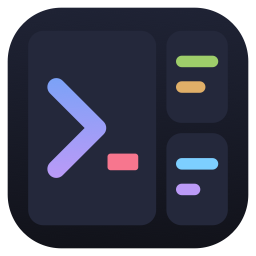
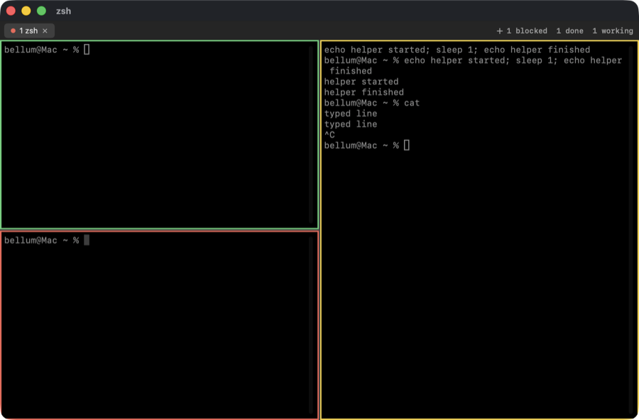
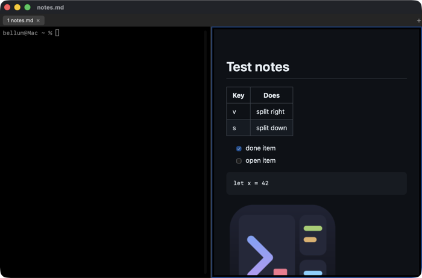
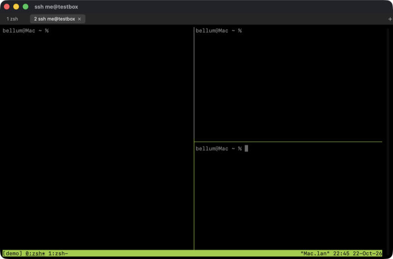

<p align="center"></p>

# lterm-mac

A native macOS version of [lterm](https://github.com/b-3llum/lterm), my terminal for Windows and Linux.
It has splits, tabs, a copy mode, inline images, Markdown and browser panes, SSH sessions that survive a
disconnect, and pane borders that show what your coding agents are doing.

It is written from scratch in Swift (no Rust code was ported). The terminal itself is
[SwiftTerm](https://github.com/migueldeicaza/SwiftTerm).



| Markdown with images | SSH session with tmux splits |
|---|---|
|  |  |

## Build

You need macOS 14 or newer, Xcode 26 or newer, and [XcodeGen](https://github.com/yonaskolb/XcodeGen)
(`brew install xcodegen`).

```
make            # generates LtermMac.xcodeproj and builds the app and the lterm tool
make run        # builds and opens the app
make test       # runs the unit tests
make release    # release build
```

The app ends up in `~/Library/Developer/Xcode/DerivedData/lterm-mac/Build/Products/Debug/lterm-mac.app`.

To use Xcode instead, run `xcodegen generate`, open `LtermMac.xcodeproj` and press Run. Two one-time things:

- Xcode asks you to trust the SwiftTermBuildInfoPlugin that comes with SwiftTerm. Click "Trust & Enable".
  (`make` skips this check with `-skipPackagePluginValidation`.)
- If the build says the Metal toolchain is missing, run `xcodebuild -downloadComponent MetalToolchain`.
  SwiftTerm has a Metal shader and new Xcodes download the Metal compiler separately.

`swift build` and `swift test` also work in the repo folder. They build the UI-free core, the `lterm`
tool and the tests. The app itself needs Xcode.

## Install

1. Copy `lterm-mac.app` to `/Applications`.
2. Run `/Applications/lterm-mac.app/Contents/Resources/bin/lterm install`.
   This links the `lterm` tool into `~/.local/bin`. Inside lterm panes `lterm` already works without this.

## Use

```
lterm                          # open a window
lterm -e htop                  # open a window that runs a command
lterm md notes.md              # read Markdown with images (--split to put it next to you)
lterm img photo.png            # show an image in the terminal
lterm --attach user@server     # SSH into a tmux session you can come back to
lterm keys                     # list every shortcut
```

### Shortcuts

Press **Ctrl+Space**, let go, then press a key. `Ctrl+Space ?` shows all of them in the window.

| After Ctrl+Space | Action | After Ctrl+Space | Action |
|---|---|---|---|
| `v` / `s` | split right / down | `t` | new tab |
| `h j k l` or arrows | move between panes | `n` / `p` | next / previous tab |
| `H J K L` | resize (tap again to repeat) | `1` to `9` | go to tab |
| `o` | next pane | `w` | close tab |
| `z` | zoom pane / restore | `c` | copy mode |
| `x` | close pane | `/` | search scrollback |
| `a` | agents sidebar | `u` | next agent that needs you |
| `d` / `r` | detach / reconnect (SSH) | `?` | help |

Normal Mac shortcuts work too:

| Keys | Action |
|---|---|
| Cmd+T | new tab |
| Cmd+D / Cmd+Shift+D | split right / down |
| Cmd+W | close pane (Cmd+Option+W closes the tab) |
| Cmd+Shift+] / [ , Cmd+1 to 9 | next / previous tab, go to tab |
| Cmd+= / Cmd+- / Cmd+0 | font bigger / smaller / reset |
| Cmd+C / Cmd+V | copy / paste |
| Cmd+F, Cmd+G, Cmd+Shift+G | search scrollback, next, previous |
| Ctrl+Shift+A | agents sidebar |

**Copy mode** (`Ctrl+Space c`): move with `h j k l`, `w b`, `0 $`, `g G` and `ctrl-u` / `ctrl-d`.
Press `v` (characters) or `V` (lines) to select, `y` to copy, `/` to search, `n` / `N` for the next or
previous match, and `q` to quit.

**Mouse:** click a pane to focus it, drag a divider to resize, drag to select text.

### Coding agents

Each pane has an agent state, shown as a colored border:

| Border | Means |
|---|---|
| Yellow, `working` | The agent is generating or running tools. |
| Red, `blocked` | It is waiting for you: a permission prompt or a question. |
| Green, `done` | It finished its turn. The border fades once you have looked at the pane. |

Tabs get a dot in the color of their most urgent agent, and the tab bar counts agents by state.
The Dock icon bounces when an agent finishes or gets blocked while lterm is in the background.
Desktop notifications from programs (OSC 9, 777 and 99) also turn a pane red until you look at it.

- `Ctrl+Space a` (or Ctrl+Shift+A) opens the agents sidebar: every pane in every window with its state
  and question. Click one to go there.
- `Ctrl+Space u` jumps to a blocked agent first, then to one that finished. Keep pressing it to go through them.

Turn it on once per agent, then restart the agent:

```
lterm integration install claude   # Claude Code: hooks in ~/.claude/settings.json (a backup is kept)
lterm integration install codex    # Codex: a notify command in ~/.codex/config.toml (a backup is kept)
lterm integration                  # show what is installed, `uninstall` removes it
```

Any other tool can report its own state with `lterm pane state working|blocked|done|idle|none --agent NAME`.

### Let agents and scripts drive panes

Programs in a pane know their pane id from `$LTERM_PANE_ID`. They can open panes, type into them,
read them and wait for them:

```
id=$(lterm pane split --run "claude 'fix the failing auth tests'")   # prints the new pane id
lterm pane wait $id --state done,blocked    # until it finishes or needs someone
lterm pane wait $id --idle 5                # or until it printed nothing for 5 seconds
lterm pane read $id --lines 40              # its last 40 lines
lterm pane send $id "also run the linter"   # type a line and press Enter
lterm pane keys $id esc                     # press keys: enter, esc, up, ctrl-c, ...
lterm pane list                             # every pane: id, tab, size, focus, state, title
lterm pane close $id
```

The Claude Code integration also adds a small skill (`lterm-mac-panes`) that tells Claude how to use
these commands, so you can just ask it to split work across helpers in panes.
`lterm pane --help` lists every option.

### Browser pane

`lterm browse` opens a web page in a pane next to yours. Scripts and agents can drive it, and you can use
it too (Ctrl+L address bar, Ctrl+B / Ctrl+F back / forward, Ctrl+R reload, Ctrl+Q close).

```
lterm browse open localhost:3000                  # prints the pane id
lterm browse click --text "Sign in"               # or a CSS selector, or --at X Y
lterm browse type --selector "#email" ada@example.com --enter
lterm browse wait --text "Welcome"
lterm browse text main                            # or links, html, title
lterm browse eval "document.title"
lterm browse shot page.png
```

### SSH sessions

```
lterm --attach user@server          # or -s NAME for more than one session
```

This opens a tab that runs `ssh -t user@server` and starts (or rejoins) a tmux session called `lterm` on
the server. Inside that tab the layout keys go to tmux: `Ctrl+Space v` splits, `t` makes a new tmux window,
`h j k l` move, and so on. Those splits live on the server.

- **Detach:** `Ctrl+Space d`, or close the window. Everything keeps running on the server.
- **Come back:** run the same `--attach` command. tmux brings back the windows, splits and scrollback.
- **Connection dropped?** The tab stays open. Press `Ctrl+Space r` to reconnect.
- Custom ssh options: `LTERM_SSH="ssh -p 2222" lterm --attach user@server`.

Compared to the Rust lterm:

| | Rust lterm | lterm-mac |
|---|---|---|
| What runs on the server | its own lterm session server (`lterm push`) | tmux (you install it there) |
| Splits and tabs after reattach | real lterm tabs and splits | tmux windows and splits inside one lterm tab |
| Scrollback after reattach | yes | yes, with tmux copy mode (`Ctrl+Space c` or `/`) |
| Password prompts | small popup window | in the terminal, like normal ssh |
| Agent states from the server | yes | no (hooks on the server cannot reach the Mac) |
| `lterm ls`, `lterm kill NAME` | yes | use `tmux ls` and `tmux kill-session -t NAME` on the server |
| Browser panes over SSH | yes | no, browser panes run on the Mac |

## Settings

Settings are plain macOS defaults:

```
defaults write com.b3llum.lterm-mac fontSize 14
defaults write com.b3llum.lterm-mac fontName "JetBrains Mono"
defaults write com.b3llum.lterm-mac leader ctrl+a          # or alt+space, f12, ...
defaults write com.b3llum.lterm-mac scrollback 50000       # lines per pane, default 10000
defaults write com.b3llum.lterm-mac shellIntegration -bool false
```

`LTERM_LEADER=ctrl+a` also works, for one launch.

## Design notes

Decisions I made along the way:

- **Icon.** The original lterm draws its logo in code (`src/logo.rs`), so there was no SVG to copy. I
  translated the same shapes and colors into `assets/logo.svg` (plus `logo-small.svg`, the simpler version
  the original uses under 40 px). `make icon` renders the app icon from them. The tile is scaled to Apple's
  icon grid so it is the same size as other Dock icons.
- **App structure.** A plain AppKit app (main.swift and an app delegate, menus built in code). The pane
  area is AppKit because SwiftTerm views are NSViews. SwiftUI is used for the tab bar, the agents sidebar
  and the help sheet.
- **Testable core.** Everything that does not need a window lives in the `LtermCore` Swift package:
  the layout tree, the leader keymap, copy mode, agent rules, the control protocol, the CLI argument
  parser, the Claude and Codex config editors and the ssh/tmux command builder. `swift test` runs 50 tests.
- **Versions.** SwiftTerm is pinned to v1.20.0 and swift-markdown to 0.8.0, both stable releases.
- **Build output** goes to `~/Library` (DerivedData and the SwiftPM cache), not the repo folder. My repo
  lives on an iCloud-synced Desktop, and iCloud adds file attributes that break code signing.
- **Panes** are a binary tree. Moving between panes picks the neighbor by position on screen (ties go to
  the top-left one). Resize moves the nearest divider that crosses that direction by 5%, like tmux, and
  after one resize the same keys keep working for 1.5 seconds without the leader.
- **Leader twice** sends the leader key itself to the program (Ctrl+Space is a NUL byte).
- **New splits and tabs** start in the focused shell's current folder. It is read from the process table,
  so no shell setup is needed.
- **Closing.** Cmd+W closes the pane. The last pane closes the tab and the last tab closes the window.
- **Tabs** are drawn by lterm, not native macOS window tabs, so they can show agent dots and work with
  the leader keys.
- **Search** uses SwiftTerm's built-in find bar.
- **Copy mode** drives SwiftTerm's own selection, so it looks like a mouse selection. The cursor is a
  one-cell highlight. Search uses smart case (all lowercase ignores case).
- **Scrollback** is 10,000 lines (SwiftTerm's default is 500).
- **Agent states** live in one app-wide store. Urgency is blocked, then done-but-not-seen (or a
  notification), then working, then idle. A pane counts as seen when it is focused in the front window
  while lterm is the active app. If you are already looking at a pane when it finishes, it flashes green
  and fades. OSC 9;4 progress reports are not treated as notifications.
- **Control socket.** A Unix domain socket at `~/Library/Application Support/lterm-mac/lterm.sock`
  (file mode 0600, folder 0700). Each connection sends one JSON line and gets one JSON line back.
  `pane wait` keeps the connection open and checks every 100 ms. The CLI gives up after 30 seconds for
  normal commands. The app removes the socket when it quits or gets SIGTERM. If a client goes away (for
  example a killed `pane wait`), the app stops working on its request. A second running copy of the app
  does not take over the socket of the first one.
- **Signals.** The app catches SIGTERM, SIGINT, SIGHUP and SIGPIPE with small handlers instead of ignoring
  them, because ignored signals would be passed on to every program started in a pane (and then Ctrl+C
  would not work there).
- **Panes get** `LTERM_PANE_ID`, `LTERM_SOCKET`, `TERM_PROGRAM=lterm` and the app's bundled `bin` folder on
  `PATH`. The `lterm` tool is a separate build target copied into `lterm-mac.app/Contents/Resources/bin`.
- **zsh integration.** zsh panes start with `ZDOTDIR` pointing at a tiny file that loads your own zsh files
  unchanged, then moves lterm-mac's `bin` folder to the front of `PATH` just before the first prompt.
  That way `lterm` in a pane is always lterm-mac, even if your startup files put another `lterm` first.
- **`pane split --run CMD`** types the command into a normal shell (after its first prompt) instead of
  replacing the shell. The pane stays open when the command ends, so you can still read it.
  Splits asked for from inside a pane keep the keyboard where you are typing, unless you pass `--focus`.
- **Hooks never fail.** `lterm pane state` outside lterm, or while the app is closed, quietly does nothing
  and exits 0.
- **The CLI starts the app** when needed for commands that create something (`lterm`, `pane split`, `md`,
  `browse open`, `--attach`). Other commands just say lterm is not running.
- **`pane wait`** prints the state it saw and exits 1 on timeout. If the state already matches, it returns
  right away.
- **Claude Code hooks:** SessionStart means idle. UserPromptSubmit and PostToolUse mean working.
  PermissionRequest, Notification (permission_prompt and elicitation_dialog) and PreToolUse for
  AskUserQuestion mean blocked, with the question or "Allow Bash: cmd?" taken from the hook's input.
  Stop means done. SessionEnd clears the state, but a pane that just finished stays done so `claude -p`
  helpers can be waited on. There is no catch-all PreToolUse hook because hooks for one event run in
  parallel and it would race the AskUserQuestion one. I tested this with Claude Code 2.1.309, including
  a real permission prompt.
- **Editing settings.json safely.** Every hook command ends with `# lterm-mac` and uses the absolute path of
  the `lterm` tool, with a 10 second timeout. Uninstall removes only those. The file is backed up to
  `settings.json.lterm-backup-DATE` first, and older backups are never overwritten. The file is rewritten
  with sorted keys. If it is not valid JSON, nothing is changed.
- **The skill** is called `lterm-mac-panes` so it never replaces the original lterm's `lterm-panes` skill.
- **Codex** gets a top-level `notify = [...]` line in `~/.codex/config.toml` that reports done. lterm will
  not replace a notify setting you wrote yourself. Codex only reports finished turns, so pressing Return in
  a Codex pane counts as working. `CLAUDE_CONFIG_DIR` and `CODEX_HOME` are respected.
- **`lterm install`** refuses to replace a file in `~/.local/bin` that is not an lterm-mac link (like the
  original lterm), unless you pass `--force`.
- **Markdown** uses Apple's swift-markdown (GitHub style: tables, task lists, strikethrough), turned into
  HTML and shown in a WKWebView with a dark GitHub-like style. Relative and absolute images, remote images
  and raw HTML work. Page scripts are off. The view reloads when the file changes and keeps its scroll
  position. `j k d u g G` scroll and `q` closes. Links open in your browser, links to other `.md` files
  open in a new tab.
- **Inline images** come from SwiftTerm: Sixel, the iTerm2 protocol (OSC 1337) and the Kitty graphics
  protocol all work. `lterm img FILE` prints any image with the iTerm2 protocol, since most Macs do not
  have `imgcat`.
- **SSH sessions** use tmux on the server. The session gets a second tmux prefix (Ctrl+]) that is set only
  on that session, so lterm can open tmux's command prompt without knowing your own prefix. lterm sends the
  prefix, waits 120 ms, then types the command, because tmux opens its prompt asynchronously. A clean
  detach closes the tab. Any other exit keeps it open to reconnect. Host names with spaces or shell
  characters are rejected (put ssh options in `LTERM_SSH`).
- **Browser panes** are a WKWebView (Safari's engine) with a small toolbar, instead of a headless Chrome
  streamed as images like the original. Each one has a private profile that is thrown away when it closes.
  `browse` commands go to the browser pane you opened or focused last, or `--pane ID`. `open`, `go`, `click`,
  `type --enter`, `back`, `forward` and `reload` wait for the page to load. `click --text` tries an exact
  text match first, then "contains". `type` uses the native value setter and fires input and change events
  so React forms notice. `eval` tries the code as an expression first, then as statements. Page `alert()`
  and `confirm()` boxes are not shown (confirm answers yes), so a page cannot block a script.

## Known gaps

- **Ctrl+Space and input sources.** macOS uses Ctrl+Space for "Select the previous input source". If you
  have more than one keyboard input source, turn that shortcut off in System Settings > Keyboard >
  Keyboard Shortcuts > Input Sources, or pick another leader.
- **bash and fish** do not get the PATH fix, so if your startup files put the original lterm first, a bare
  `lterm` inside a pane runs the original. Hooks use absolute paths, so agent states still work.
- **Old hooks.** If the original lterm's Claude hooks are still installed, they print "no pane" errors inside
  lterm-mac panes. Remove them with the original tool if you switch.
- **Codex** was only tested with unit tests on the config file (Codex is not installed on my Mac).
- **macOS folder permissions.** The first time a program in a pane touches Desktop, Documents or Downloads,
  macOS asks "lterm-mac would like to access files in your Desktop folder". The program waits until you
  answer. Every terminal app gets this.
- **Copy mode** counts columns in characters, so lines with wide characters (CJK, some emoji) can be off by
  one cell.
- **SSH:** tmux must be installed on the server. Ctrl+Space 1 to 9 picks tmux window numbers, and tmux
  counts from 0 unless you set `base-index 1`. lterm's own Cmd+T and Cmd+D still make local tabs and splits.
- **Browser panes** cannot load addresses WebKit blocks (like ports 1 and 9). `browse` reports that as an
  error. There are no downloads, logins are not kept, and sites that need Chrome may look different.
- **No session restore** for local windows: closing lterm closes its shells (only `--attach` sessions survive).
- **Not notarized.** The app is only signed to run locally. If you download a build (for example from the
  GitHub Actions artifact), macOS blocks it the first time. Allow it in System Settings > Privacy & Security,
  or build it yourself.

## License

MIT, see [LICENSE](LICENSE).
